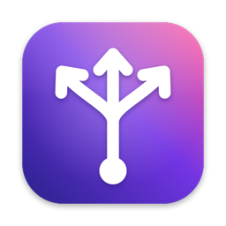
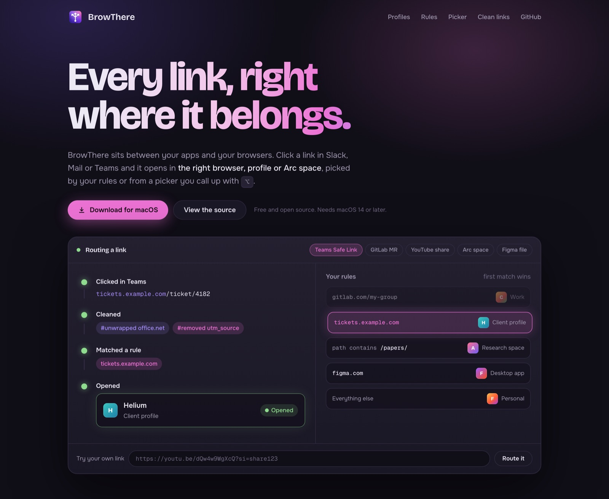

<p align="center">
  
</p>

<h1 align="center">BrowThere</h1>

<p align="center">
  <b>Every link, right where it belongs.</b><br>
  A tiny macOS app that opens each link in the right browser, profile or Arc space,<br>
  by your rules or from a picker you call up with ⌥.
</p>

<p align="center">
  <a href="https://github.com/echaouchna/browthere/releases/latest"><b>Download for macOS</b></a>
  &nbsp;&nbsp;|&nbsp;&nbsp;
  <a href="docs/index.html">Website</a>
  &nbsp;&nbsp;|&nbsp;&nbsp;
  <a href="#build-from-source">Build from source</a>
</p>

<p align="center">
  
  
  
  
</p>

<p align="center">
  
</p>

---

BrowThere becomes your default browser, but it never shows you a web page. When you click a link in Slack, Mail, Teams or anywhere else, it cleans the link, checks your rules and hands it to the browser you'd have picked yourself, in the right profile. It's a lighter, open-source alternative to Velja and Choosy.

## What it does

### Profiles, not just browsers

BrowThere reads the profiles you already have, with their names, emails and colors, and treats each one as a destination.

| Browser family | Where profiles come from |
| --- | --- |
| Chrome, Edge, Brave, Vivaldi, Helium, Chromium, Thorium, Comet, Whale, Yandex | `Local State` |
| Firefox, Zen, Floorp, Waterfox, LibreWolf | `profiles.ini` |
| Arc | Its sidebar data. Each **space** is a destination, and links open as a new tab in it. |
| Anything else | Add profiles by hand: a Chromium folder, a Firefox profile name, an Arc space name, or your own launch arguments (`{url}` is replaced by the link). |

Unknown Chromium or Gecko browsers are recognised by their data folder. If a profile already has a window open, the link lands as a tab there, not in a new window.

### Rules that read like sentences

- Match a **site**: a domain with its subdomains, or a domain plus path such as `gitlab.com/my-group`, which also covers everything under it.
- Or match the full URL, the path, a wildcard or a regex, or the **app the link came from**. Combine conditions with *all* or *any*.
- Send matches to any browser, profile or space, to a **private window**, to another app (Zoom, Figma, Slack…), or to the picker.
- Rules are checked from the top, and the first match wins. Paste a link into the built-in tester to see which rule catches it.
- Links no rule catches go to your fallback, which you set on the overview page or in the "Everything else" row.

### Hold ⌥ and choose

Option-click any link and a Raycast-style command bar drops in. Type to filter by browser, profile or account email.

| Keys | Action |
| --- | --- |
| `↑` `↓` then `↩` | Open the selected destination |
| `⌘1` to `⌘9` | Open one directly |
| `⇧↩` | Open in a private window |
| `⌘↩` | Always open this site there (it writes the rule for you) |
| `⌘C` | Copy the link |
| `esc` | Clear the search, then close |

### Links arrive clean

- **Unwraps redirects**: Outlook and Teams Safe Links, Google, Facebook, Instagram, Slack, LinkedIn and YouTube, so your rules see the real site.
- **Removes tracking**: `utm_*`, `fbclid`, `gclid`, `msclkid`, `mc_eid` and friends, plus YouTube's `si` and `is`.
- **Your own list**: add `name` to strip it everywhere, `prefix*` for every parameter starting with it, or `domain:name` for one site and its subdomains.

### So light you'll forget it's running

Native Swift, with no web view and no background timers. It idles at about **18 MB** of memory with **0% CPU** and 3 threads (measured on an Apple Silicon Mac), and the app is a **2 MB** download. The picker is pure AppKit; the settings window is SwiftUI and is torn down when you close it. It opens at login if you want, and only one copy ever runs.

BrowThere makes no network requests. Your rules stay in `~/Library/Application Support/BrowThere/config.json`.

## Install

1. Download the zip from [Releases](https://github.com/echaouchna/browthere/releases/latest), unzip it and move **BrowThere** to Applications.
2. The first time, macOS may say it can't be verified. Open **System Settings → Privacy & Security** and click **Open Anyway**, or run:
   ```sh
   xattr -dr com.apple.quarantine /Applications/BrowThere.app
   ```
3. Open BrowThere and click **Make Default**.

macOS may also ask once to let BrowThere read other apps' data (that's how it lists browser profiles), and to control Arc if you route links to Arc spaces.

## Build from source

You need macOS 14 or later and Xcode. The Command Line Tools alone don't include the SwiftUI macros.

```sh
./scripts/build-app.sh             # build/BrowThere.app
./scripts/build-app.sh --install   # also copies it to /Applications
swift test                         # rule engine, link cleaning, profile and space parsing
./scripts/release.sh --publish     # zip it and upload a GitHub release
```

`release.sh` signs and notarizes the app when you pass a Developer ID; see the comments at the top of the script.

The website lives in [`docs/`](docs/index.html) and is a single static page, ready for GitHub Pages.

## Known limits

- Safari can't be told which profile to open a link in from outside the browser, so it appears as one entry.

## License

Copyright (c) 2026 Nabil Echaouch. Released under the [MIT License](LICENSE).
